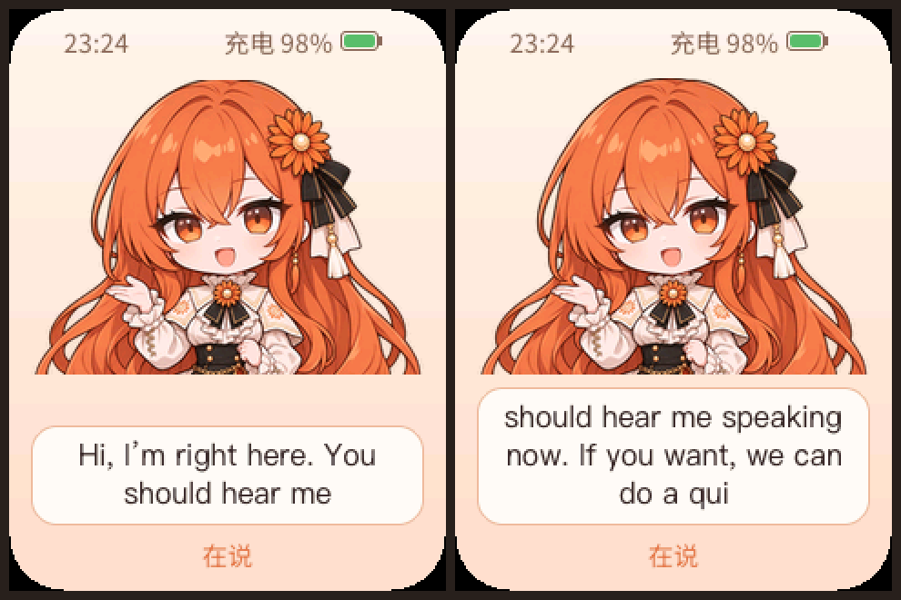
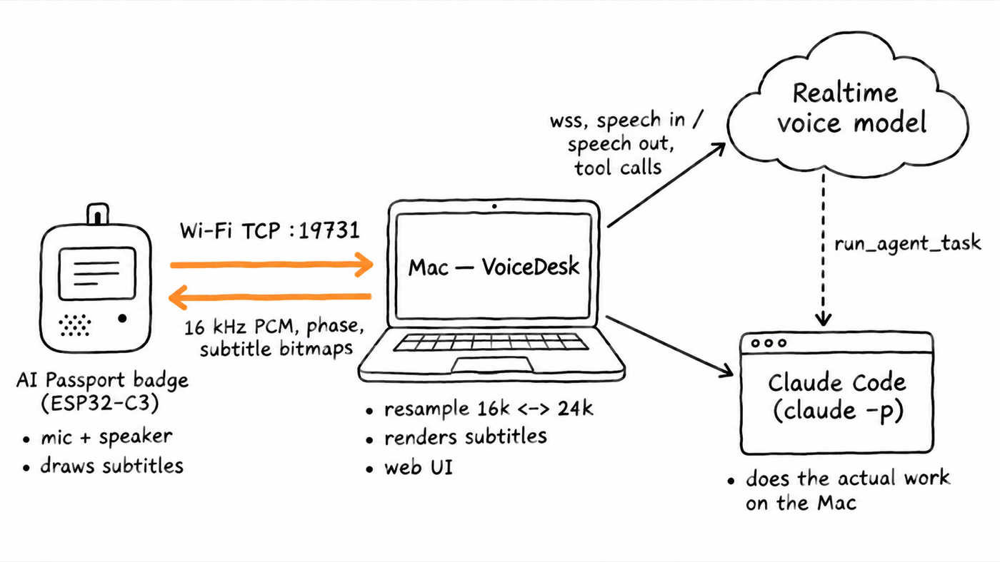
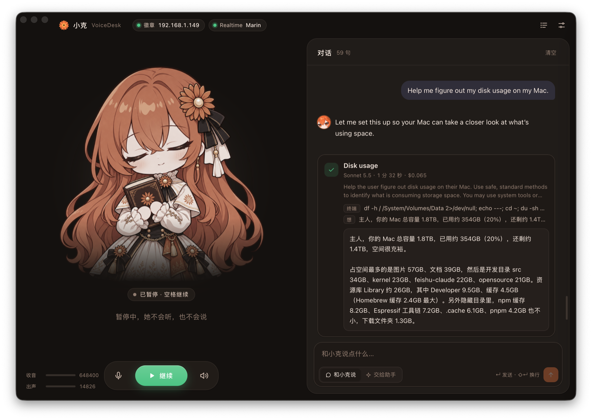

# claude-chan-badge

把 FoloToy AI Passport 徽章（ESP32-C3）做成一个语音助手。徽章负责收音、放音和显示，Mac 上的 VoiceDesk 负责连接 Realtime 语音模型，并把需要在电脑上执行的任务交给 Claude Code。




## 功能

- 全双工语音对话：徽章麦克风采集，模型的回答从徽章喇叭播放。
- 实时字幕：用户的话（语音转写）和模型的回答按播放进度逐字显示，徽章屏幕和 Mac 窗口同步。
- 后台任务：模型通过工具调用启动 Claude Code（`claude -p`），在 Mac 上读写文件、执行命令、查询网页。任务进度显示在窗口里，完成后用语音播报结果。
- 快捷操作：打开应用、打开网址。
- 暂停：在徽章按键或 Mac 窗口任一处暂停，另一处同步。

## 架构



徽章与 Mac 在局域网内通过一条 TCP 连接通信，传输 16 kHz PCM 音频、对话阶段和字幕位图。与模型服务的 WebSocket、TLS、API 密钥和重采样都在 Mac 上处理，徽章不保存任何凭据。

| 目录 | 内容 |
| --- | --- |
| `mac/VoiceDesk` | Mac 端程序（Swift，界面为 WKWebView 页面） |
| `badge/app` | 徽章界面，C + LVGL 9，不依赖 ESP-IDF |
| `badge/firmware` | ESP-IDF 5.5 工程：局域网语音、Wi-Fi、平台层 |
| `badge/firmware/third_party/ai-passport` | 子模块 [FoloToy/ai-passport](https://github.com/FoloToy/ai-passport)，提供板级支持包 |
| `badge/assets/fonts` | 状态栏使用的中文字体（Noto Sans SC GB2312 子集） |
| `tools/fake_badge.py` | 模拟徽章的测试脚本 |
| `docs/` | [帧格式](docs/protocol.md)、[开发手册](docs/development.md) |

## 环境要求

| 用途 | 要求 |
| --- | --- |
| VoiceDesk | macOS 14 及以上，Swift 6（Xcode 16 及以上） |
| 语音模型 | 兼容 OpenAI Realtime 接口的服务及其 API 密钥 |
| 后台任务（可选） | 已安装并登录的 Claude Code（`claude` 命令） |
| 固件 | ESP-IDF 5.5.3，esptool |
| 硬件 | FoloToy AI Passport，与 Mac 处于同一局域网 |

## 部署

### 1. 获取代码

固件依赖子模块，克隆时带上 `--recursive`：

```sh
git clone --recursive https://github.com/M1nt-Ch0c0/claude-chan-badge.git
cd claude-chan-badge
```

已经克隆过但没有子模块时，执行 `git submodule update --init`。缺少子模块时，固件编译会直接报错并给出这条命令。

### 2. 启动 VoiceDesk

```sh
cd mac/VoiceDesk
swift build -c release
VOICEDESK_API_KEY=... .build/release/VoiceDesk
```

VoiceDesk 监听 `0.0.0.0:19731`，等待徽章连接。开启了 macOS 防火墙时，首次运行需要允许 VoiceDesk 接受传入连接。

配置可以用环境变量，也可以写入 `~/.config/voicedesk/config.json`，环境变量优先：

| 环境变量 | 配置文件键 | 默认值 | 说明 |
| --- | --- | --- | --- |
| `VOICEDESK_API_KEY` | `api_key` | 无（必填） | 模型服务密钥 |
| `VOICEDESK_BASE_URL` | `base_url` | `https://api.openai.com` | 模型服务地址 |
| `VOICEDESK_REALTIME_MODEL` | `realtime_model` | `gpt-realtime-2.1` | 语音模型 |
| `VOICEDESK_TRANSCRIBE_MODEL` | `transcribe_model` | `gpt-4o-mini-transcribe` | 用户语音的转写模型 |
| `VOICEDESK_PORT` | — | `19731` | 监听端口 |

配置文件示例：

```json
{
  "api_key": "...",
  "base_url": "https://api.openai.com"
}
```

音色、后台任务的模型和权限在窗口右上角的设置里修改，保存在本机。

### 3. 烧录固件

**烧录前先备份整片 flash：**

```sh
esptool.py --chip esp32c3 -p /dev/cu.usbmodemXXXX read_flash 0 0x800000 backup.bin
```

本固件的应用分区从 `0x360000` 开始，会覆盖原厂固件在这之后的内容。`0x356000` 处的设备身份分区（cardid）只在分区表里声明，不会被写入。不要使用 `erase-all`。

填写网络配置：

```sh
cd badge/firmware
cp main/wifi_secret.example.h main/wifi_secret.h
```

| 宏 | 说明 |
| --- | --- |
| `CC_WIFI_SSID` / `CC_WIFI_PASSWORD` | Wi-Fi（2.4 GHz） |
| `CC_LAN_HOST` / `CC_LAN_PORT` | 运行 VoiceDesk 的 Mac 的局域网地址和端口 |
| `CC_API_BASE` / `CC_API_KEY` / `CC_MODEL` | 仅文字对话模式使用，语音模式可留空 |

`wifi_secret.h` 已在 `.gitignore` 中。Mac 的地址建议在路由器上设为固定分配，否则地址变化后需要重新编译烧录。

编译并烧录：

```sh
idf.py set-target esp32c3
idf.py build
idf.py -p /dev/cu.usbmodemXXXX flash
```

### 4. 确认连接

徽章启动后自动连接 Wi-Fi 和 VoiceDesk。连不上时每 2 秒重试，连接断开后 1 秒重连。连接成功时：

- VoiceDesk 顶栏的「徽章」显示徽章的 IP 地址；
- 徽章屏幕底部显示「按确定暂停」；
- VoiceDesk 运行日志（右上角列表图标）里有 `HELLO 16000 Hz，字幕走位图`。

连不上时，依次检查：`CC_LAN_HOST` 是否为 Mac 当前的局域网地址，两者是否在同一网段，Mac 防火墙是否放行，端口是否被其他程序占用。

### 更新

```sh
git pull
git submodule update --init
```

然后重新编译 VoiceDesk；如果 `badge/` 下有改动，重新编译并烧录固件。徽章和 VoiceDesk 之间的帧格式向后兼容：新版 VoiceDesk 可以配合旧固件使用（字幕改用文字帧发送）。

## 使用

### 徽章按键

| 操作 | 作用 |
| --- | --- |
| 确定单击 | 暂停 / 继续 |
| 确定双击 | 摸头 |

### VoiceDesk 快捷键

| 按键 | 作用 |
| --- | --- |
| 空格 | 暂停 / 继续 |
| `⌘K` 或 `/` | 聚焦输入框 |
| `Esc` | 关闭日志和设置 |

输入框有两种模式：「和小克说」作为对话发送，「交给助手」直接创建后台任务。

### 后台任务权限

| 级别 | 允许 | 说明 |
| --- | --- | --- |
| 只看 | 读文件、搜索、读网页 | 不修改任何内容 |
| 标准（默认） | 以上，加写文件、执行命令 | 禁止 `rm`、`sudo`、`git push`、`shutdown`、`diskutil` 等命令 |
| 完全 | 不限制 | 跳过 Claude Code 的权限检查。语音识别出错的指令也会被执行，谨慎使用 |

单个任务超过 10 分钟会被终止。可选模型为 Sonnet 5.5（默认）和 Opus 5.5。



## 不接徽章测试

```sh
VOICEDESK_PORT=19732 mac/VoiceDesk/.build/release/VoiceDesk &
python3 tools/fake_badge.py "帮我看看下载文件夹里最大的两个文件" --port 19732 --seconds 40 --bitmap /tmp/subs
```

脚本先用 TTS 生成这句话的语音，按实时速度发给 VoiceDesk，然后打印收到的阶段、字幕和音频帧速率；指定 `--bitmap` 时，把每次收到的字幕位图保存为 PNG。脚本使用与 VoiceDesk 相同的密钥配置。

## 已知限制

- 不支持打断：模型说话期间及结束后 0.4 秒内，麦克风输入被丢弃（没有回声消除）。
- Mac 的地址写在固件里，没有自动发现。
- 模型回答的语言会跟随用户，系统提示里指定的普通话不总能生效。
- 部分中转服务下，Claude Code 使用 Haiku 5.5 时，第一次工具调用后返回 400，因此设置中没有提供 Haiku。
- 为保证语音稳定，固件关闭了 Wi-Fi 省电模式，功耗高于原厂固件，具体数值未测量。
- 仅在单台设备上测试过。

## 许可

本项目的代码和立绘采用 MIT 许可，见 [LICENSE](LICENSE)。

- 板级支持包来自子模块 [FoloToy/ai-passport](https://github.com/FoloToy/ai-passport)，MIT 许可。
- `badge/assets/fonts/NotoSansSC-GB2312.ttf` 是 Noto Sans SC 的子集，SIL Open Font License 1.1。
