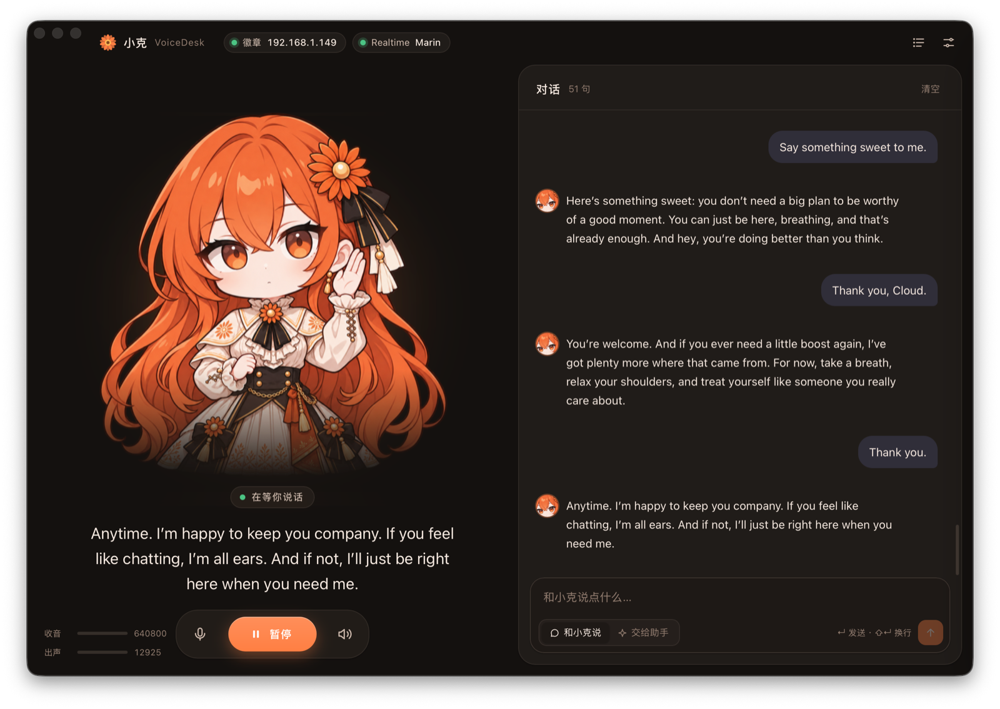

# claude-chan-badge

我桌上有一块 FoloToy 的 AI Passport 徽章（ESP32-C3，240×320 的小屏，带麦克风和喇叭）。这个仓库把它变成了「小克」：对着徽章说话，她用声音回你，字幕同时出在徽章屏幕和 Mac 上；要动手的事，比如找文件、查资料、看磁盘，她会交给这台 Mac 上的 Claude Code 去做，做完再念给你听。



徽章上是这样的（真机截屏，说话时字幕一行行长出来，满三行往上滚）：


## 怎么连起来的


徽章不直接连模型。它只在局域网里和 Mac 互相收发 16 kHz 的 PCM，外加几个很小的控制帧。WebSocket、TLS、密钥、重采样都在 Mac 上。

原因很简单：C3 只有 400 KB 左右的 SRAM，屏幕、字体、立绘、Wi-Fi 一起开起来之后，再做一次 TLS 握手，空闲内存就只剩 20 KB 出头了，音频缓冲根本放不下。局域网明文 TCP 没有这笔开销。

Mac 这边的程序叫 VoiceDesk，做三件事：

1. 连 Realtime 语音模型（OpenAI 兼容的 `wss://…/v1/realtime`），把徽章的声音转成 24 kHz 送上去，把回来的声音转回 16 kHz，按实时速度发给徽章。
2. 把双方说的话排成字幕位图，只发变了的行给徽章；Mac 窗口里也同步显示。
3. 模型调用 `run_agent_task` 时，在后台起一个 `claude -p`（Claude Code 的无头模式）去干活，窗口里能看到它每一步在做什么，做完小克会主动把结果说出来。

帧格式见 [docs/protocol.md](docs/protocol.md)。

## 目录

```
mac/VoiceDesk/      Mac 端（Swift + 一个 WKWebView 页面）
badge/app/          徽章上的界面，纯 C + LVGL 9，不依赖 ESP-IDF
badge/firmware/     ESP-IDF 5.5 工程（局域网语音、Wi-Fi、平台层、FoloToy 的 BSP）
badge/assets/fonts/ 状态栏用的中文字体（Noto Sans SC 的 GB2312 子集）
tools/fake_badge.py 没有徽章时用的假徽章，会把收到的字幕位图存成 PNG
```

## 跑 Mac 端

需要 macOS 14 以上和 Swift 6（装了 Xcode 就有）。

```sh
cd mac/VoiceDesk
export VOICEDESK_API_KEY=sk-...                   # 必填
export VOICEDESK_BASE_URL=https://api.openai.com  # 默认就是这个，走中转就改掉
swift build && .build/debug/VoiceDesk
```

也可以写到 `~/.config/voicedesk/config.json`：

```json
{
  "base_url": "https://api.openai.com",
  "api_key": "sk-...",
  "realtime_model": "gpt-realtime-2.1",
  "transcribe_model": "gpt-4o-mini-transcribe"
}
```

说实话，我自己一直是经一个兼容 OpenAI 的中转跑的，没直接连过官方地址。模型名对不上的话，用 `VOICEDESK_REALTIME_MODEL` 改。

后台任务要本机装好 `claude` 命令并且已经登录。设置里可以选模型（Sonnet / Opus）和权限：

- 只看：只能读文件、搜网页
- 标准（默认）：能读写文件、跑命令，但 `rm`、`sudo`、`git push` 这类会被拦下
- 完全：不设限制。语音听错一句它也会照做，我自己不常开


没有徽章也能先试：

```sh
VOICEDESK_PORT=19732 .build/debug/VoiceDesk &
python3 tools/fake_badge.py "小克，帮我看看下载文件夹里最大的两个文件" --port 19732 --seconds 40 --bitmap /tmp/subs
```

假徽章会用 TTS 把这句话念给 VoiceDesk 听，再把收回来的阶段、字幕和音频速率打出来。

## 刷徽章

需要 ESP-IDF 5.5.3。

```sh
cd badge/firmware
cp main/wifi_secret.example.h main/wifi_secret.h   # 填 Wi-Fi 和 Mac 的局域网地址
idf.py set-target esp32c3
idf.py build
idf.py -p /dev/cu.usbmodemXXXX flash
```

刷之前请先把整片 flash 备份下来（`esptool.py read_flash 0 0x800000 backup.bin`）。注意两点：

- `0x356000` 是原厂的设备身份分区（cardid），这里只声明、从不写。千万别用 `erase-all`。
- 应用放在 `0x360000` 之后，会盖掉原厂放在高地址的 Recovery。想回原厂固件就靠这份备份。

徽章上的操作：确定单击是暂停 / 继续（和 Mac 上的按钮同步），确定双击是摸头。

`badge/firmware/tools/cc_bridge.py` 是 USB 调试桥。它打开串口时不会让芯片复位，能截屏、注入按键、看内存。下面那些内存数字都是用它看的。

## 关于内存

这个项目里最花时间的不是语音，是内存。记几个数字，以后改的人少踩坑：

- 刚开机、Wi-Fi 还没开：空闲 188 KB。连上 Wi-Fi：135 KB。进入界面：76 KB。
- 字幕最早是徽章自己用 TinyTTF 排字，字形缓存跟着说过的字一路涨。有一次语音和字幕一起卡住，后来声音又跳着续上了，画面却再也不动。原因是 LVGL 申请内存失败后，默认的断言就是 `while(1)`，界面任务原地转圈，音频任务照常在跑。现在断言改成了 panic 重启。
- 第二个坑在 Wi-Fi 省电模式。路由器把 20 ms 一个的小包攒起来，每 100 ms 左右成串送过来，每个小包各占一块约 1.6 KB 的接收缓冲。徽章每轮只读 1 KB，读不完就越积越多，6 分钟里空闲内存从 50 KB 掉到 3 KB，然后重启。现在关掉了省电，每轮把套接字读空，Mac 也把两帧拼成一个包再发。
- 第三步是裁协议栈：Wi-Fi 和 lwIP 的代码不再放进 IRAM（C3 上 IRAM 和堆共用同一块 SRAM），收发缓冲封顶，去掉 SoftAP、企业认证、IPv6、DHCP 服务端。静态内存少了 21 KB，进入界面后空闲从 76 KB 涨到 97 KB。
- 最后是字幕改由 Mac 渲染成位图。

## 还没做好的

- 不能插嘴。她说话的时候麦克风的帧是直接丢掉的，因为喇叭就贴着麦克风，这里也没有回声消除。
- Mac 的地址是写死在固件里的，还没做自动发现。
- 你用英文说，她就会用英文回，提示词里那句「说普通话」压不住。
- 经某些中转用 Haiku 跑 Claude Code，调完一次工具就会报 400，所以设置里没放 Haiku。
- 关掉 Wi-Fi 省电以后，徽章的耗电高了不少，我还没量具体多少。
- 只在我这一块徽章、一台 Mac 上跑过。

## 授权

代码、立绘都用 MIT，见 [LICENSE](LICENSE)。`badge/firmware/components/bsp` 来自 [FoloToy/ai-passport](https://github.com/FoloToy/ai-passport)，原样保留它的 MIT 授权。字体是 Noto Sans SC 的子集，用 SIL OFL 1.1，见 `badge/assets/fonts/OFL.txt`。

---

**English, briefly.** This turns a FoloToy AI Passport badge (ESP32-C3) into a small voice companion. The badge only streams 16 kHz PCM over LAN TCP to a Mac app (VoiceDesk). The Mac talks to an OpenAI-compatible Realtime model, renders subtitles into 4-bit bitmaps for the badge, and hands real work on the Mac to Claude Code (`claude -p`) through a tool call. Build notes are above; frame format is in [docs/protocol.md](docs/protocol.md).
